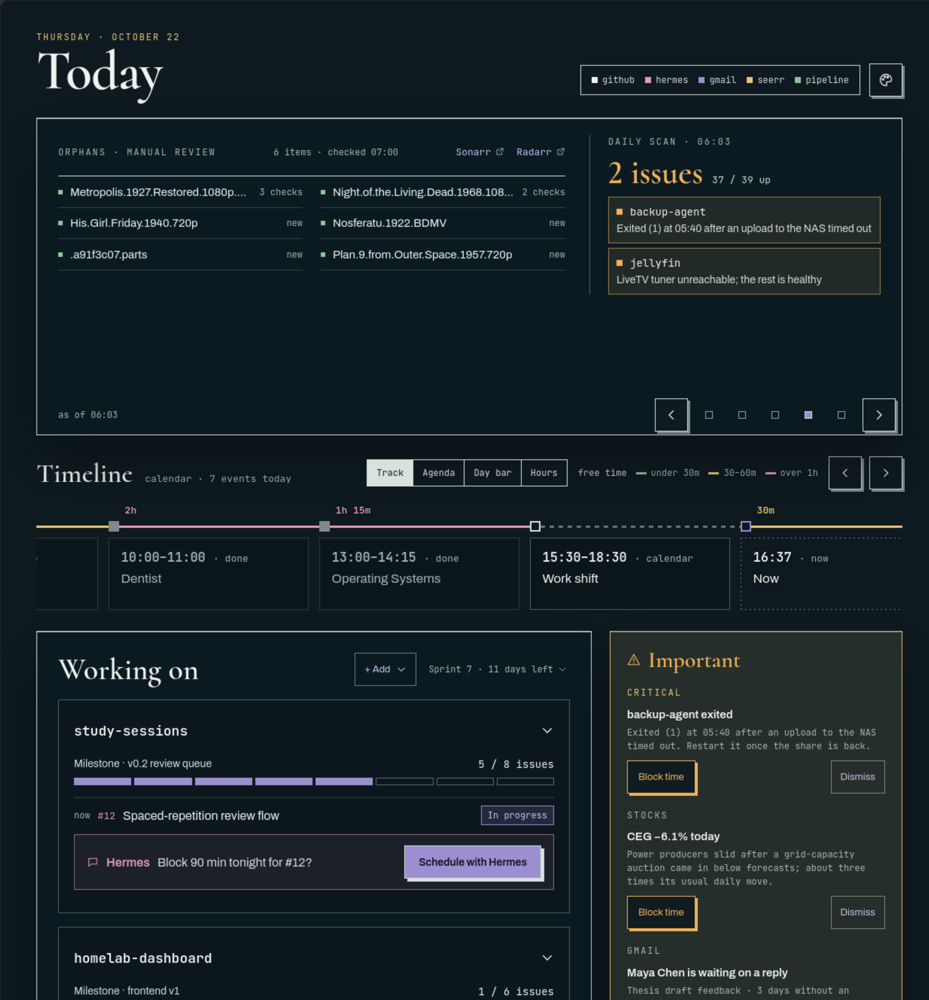
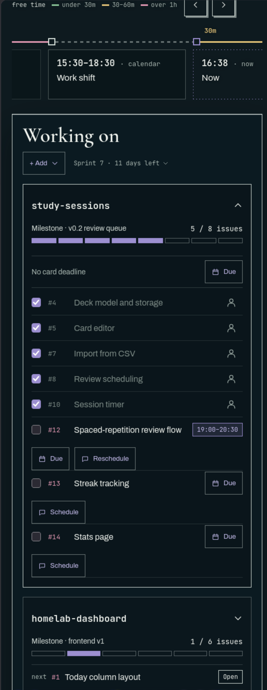

# Daily Intake

A personal, single-page daily dashboard for a homelab. One screen answers three questions: what is
on my calendar today, what am I working on, and what needs me. Background jobs
keep it current, a [Hermes](https://github.com/NousResearch/hermes-agent) agent writes to it through
an HTTP API, and every change shows up on the open page within seconds.

Stack: Next.js 16 (App Router), React 19, TypeScript, Tailwind 4, Prisma 7 + PostgreSQL 17.

## Screenshots

<!--
  Screenshots go in docs/screenshots/. Add the files, then remove this comment's start and end
  lines so the images below show up.



-->

_Screenshots coming soon._

## What's on the page

- **Banner.** Slides that rotate on their own: a daily message, a Gmail summary (needs a reply,
  packages, payments, deleted), what's left in the orphan folder plus a daily container scan, and
  your stock watchlist (the first 12 symbols) with the day's change and the 6-month change. A slide
  with no data is skipped.
- **Timeline.** Today's Google Calendar as a row of cards, with the free time between events
  colour-coded, a "now" marker, and blocks Hermes booked shown in lilac. `?date=YYYY-MM-DD` shows
  another day.
- **Working on.** Sprint cards with a checklist, a progress bar and the current item. A card can
  point at a GitHub repo to show its last commit and commits this week. When you push to that repo
  (its default branch or an open pull request), Hermes reviews the new commits and leaves push updates
  on the items they moved forward or seem to finish. It never checks one off for you. A checked item
  shows who checked it: you, Hermes, or a push you confirmed (linked to that commit).
- **Important.** Things that need you, like notifications: alerts Hermes raises (a failed backup, a
  mail left unanswered for days, an unusual move on a stock you follow), Seerr requests waiting for
  days, orphans nobody fixed, and push updates from your repos. Critical ones come first, the rest are
  grouped by source. Each one has a link or an action, and a Dismiss.
- **Notes.** Small things to remember. You add, edit and delete your own; Hermes keeps its own up to
  date (for example "PRs to review · 3"). Seerr requests to approve or decline (with a Temp /
  Permanent library switch) sit at the top.

There is no login. The page is meant to sit on your own network or VPN, with the client allowlist
from [Security](#security) in front of it.

## How it fits together

```
Google Calendar ─┐
Finnhub, Tiingo ─┤
Seerr, GitHub   ─┤
orphan folder   ─┴─► worker (background jobs) ─┐
                                               ├─► PostgreSQL ─► Next.js page ─► your browser
Hermes ──► /api/hermes/* ──────────────────────┘                (live updates over /api/stream)
```

- The **worker** is a separate process from the app. It syncs the calendar every 2 minutes, Seerr
  every 2 minutes, stock quotes and GitHub every 5 minutes, stock history once a day, and the orphan
  folder every Wednesday. It also hands new pushes on card repos to Hermes for review.
- **Hermes** pushes what only an agent can work out: the Gmail summary, the daily scan, alerts, the
  daily message, and cards, sprints and checklist items.
- Every source is optional. A section whose source isn't set up stays empty or hides itself, and the
  rest of the page keeps working.

## Quick start

You need Docker and Node.js 22.

```sh
cp .env.example .env            # set DASHBOARD_TIME_ZONE; the keys can wait
docker compose up -d            # PostgreSQL on 127.0.0.1:${POSTGRES_PORT} + the migrations
npm install
npx prisma generate
npm run db:seed                 # demo content for today (npm run db:seed -- --clean removes it)
npm run dev                     # http://localhost:3000
npm run worker                  # background jobs, in a second terminal
```

The seed fills the page with demo data, so you can see everything before any key is in. Then set up
the sources you want from the next section.

All dates and day boundaries use `DASHBOARD_TIME_ZONE` (an IANA zone such as `America/Denver`).

## Setting up each source

Every key goes in `.env` and stays on the server. The browser only talks to this app's own `/api/*`.
Each source has a command that tests it from the terminal.

### Google Calendar (timeline)

Read-only. The dashboard only reads your calendar; Hermes books events with its own Google access.

1. In the [Google Cloud Console](https://console.cloud.google.com/), create a project and enable the
   **Google Calendar API**.
2. Set up the **OAuth consent screen** (External is fine) and add your Google account as a test
   user. While the app is in "Testing", Google expires its refresh tokens after 7 days. To avoid
   re-running step 4 every week, set the publishing status to "In production". For your own account
   you don't need Google's verification; you click through the "unverified app" warning once.
3. Under **Credentials**, create an **OAuth client ID** of type **Desktop app**. Put its ID and
   secret in `GOOGLE_CLIENT_ID` and `GOOGLE_CLIENT_SECRET`.
4. Run `npm run google:auth` in your own terminal (it prints a secret). Open the sign-in link it
   prints and approve read-only access. It then prints a refresh token for `GOOGLE_REFRESH_TOKEN` and lists your calendars so you can pick
   `GOOGLE_CALENDAR_ID` (`primary` is your main calendar).
5. Test: `npm run sync:calendar`.

### Stocks (banner)

Both have free plans. Finnhub gives the live price and the day's change (every 5 minutes); Tiingo gives
the daily history used for the 6-month change.

1. Sign up at [finnhub.io](https://finnhub.io/) and copy the API key from the dashboard into
   `FINNHUB_API_KEY`.
2. Sign up at [tiingo.com](https://www.tiingo.com/) and copy the token from Account → API into
   `TIINGO_API_KEY`.
3. Pick your symbols: `npm run stocks:watchlist -- NVDA AMD TSLA`. This replaces the whole list; the
   banner shows the first 12. Hermes can change the list later too.
4. Test: `npm run sync:stocks`, then `npm run sync:stocks:history`.

### Seerr (requests to approve)

Optional. Leave `SEERR_URL` and `SEERR_API_KEY` empty and the Seerr item never appears; the worker
skips it too.

1. In Seerr, go to **Settings → General** and copy the **API Key** into `SEERR_API_KEY`.
2. Set `SEERR_URL` to the address the server uses to reach Seerr (a LAN address works), and
   `SEERR_PUBLIC_URL` to the address the "Open Seerr" link should open in your browser.
3. Approving a request first moves it to a Temp or Permanent library. Run `npm run seerr:settings` to
   list your Radarr/Sonarr servers, root folders and quality profiles, then fill in the `SEERR_MOVIE_*`,
   `SEERR_TV_*` and `SEERR_ANIME_*` values in `.env`. The same command checks them. Anime always goes
   to the anime library.
4. A request still pending after `SEERR_IMPORTANT_AFTER_DAYS` days (default 5) shows in Important,
   linked to the title in Seerr, until it is approved or declined.
5. Test: `npm run seerr:pending`.

### GitHub (card meta and push review)

1. Create a **fine-grained personal access token** (GitHub → Settings → Developer settings → Personal
   access tokens → Fine-grained tokens).
2. Repository access: all repositories, or only the ones your cards point at. Permissions:
   **Contents: Read-only** and **Pull requests: Read-only** (Metadata: Read-only is added on its own).
   Nothing needs write access.
3. Put it in `GITHUB_TOKEN`.
4. Give a card a repo (`owner/name`), then test: `npm run sync:github`. It prints the card's meta line
   and the branches the push review watches.

### Orphans folder

Optional. Leave `ORPHANS_DIR` empty and the orphans check is off. In the deploy stack it is required:
the worker gets the folder through a read-only mount (see [deploy/README.md](deploy/README.md)).

`ORPHANS_DIR` is the `orphaned_data` folder qbit_manage moves leftover downloads to. The worker only
lists its top level: each file or folder there, dotfiles included, is one orphan.

1. Every Wednesday at 07:00 (dashboard time zone) the worker checks the folder. If it was down then,
   it runs the check when it starts. An orphan still there gets one more check, a new one starts at
   1, and a gone one is removed.
2. An orphan listed on 2 Wednesday checks in a row shows in Important ("Still in orphaned_data after
   N checks") until it leaves the folder.
3. If the folder isn't mounted (empty and owned by root, which is the folder Docker creates when the
   host path doesn't exist) or can't be read, the worker logs it every hour. The Wednesday check also
   raises "Set up the orphans mount" in Important, the first two Wednesdays in a row; after that only
   the log. The next good check resolves it.
4. After you fix orphans by hand, run `npm run orphans:check`. It refreshes the list and resolves the
   fixed ones, but doesn't count as a check.

### Sonarr and Radarr (links)

`SONARR_URL` and `RADARR_URL` are only browser links on the banner's orphans panel. The app never
calls their APIs.

### Jira

The `JIRA_*` variables belong to code that is kept for a future "work" view. Nothing on the page uses
them yet; leave them empty.

## Hermes

Hermes and the dashboard talk in both directions. Each direction has its own secret.

### Hermes → dashboard

Hermes creates and updates cards, sprints, checklist items, the banner snapshots (Gmail, scan),
alerts, notes, the daily message and the stock watchlist.

1. Generate a token, for example with `openssl rand -hex 32`, and put it in `HERMES_DASHBOARD_TOKEN`.
2. In Hermes's env file, set `DAILY_INTAKE_TOKEN` to the same value and `DAILY_INTAKE_URL` to where
   Hermes can reach the dashboard (for example `http://127.0.0.1:4849` when both run on the same host).
3. Install the [`daily-intake`](skills/daily-intake/SKILL.md) skill in Hermes (see
   [Agent skills](#agent-skills)). It describes every route, how to address rows, and how to recover
   from errors.
4. Test against a running dev server: `npm run hermes:smoke`.

### Dashboard → Hermes (scheduling and push review)

"Schedule with Hermes" on a checklist item, or "Block time" on an Important alert, books a block on your calendar:

1. The page checks the time and the cached calendar first. A clash comes back right away, with a
   one-click "Use HH:MM" for the next free slot.
2. Otherwise the worker starts a run on Hermes's API server with the booking instructions. Hermes
   checks Google again, creates the event (or moves the earlier block for the same item), and answers
   with one line of JSON.
3. The worker syncs the calendar, so the block shows up on the timeline and the item shows its time.
   Hermes gets 2 minutes; closing the bubble stops the run.

To set it up:

1. In Hermes's env file: `API_SERVER_ENABLED=true` and `API_SERVER_KEY=<a long random string>`.
   Hermes listens on `127.0.0.1:8642` unless you set `API_SERVER_HOST` / `API_SERVER_PORT`.
2. In this app's `.env`: `HERMES_API_URL=http://<API_SERVER_HOST>:<API_SERVER_PORT>/v1` and
   `HERMES_API_KEY` set to Hermes's `API_SERVER_KEY`.
3. Hermes needs write access to Google Calendar, and it must be signed in to the **same Google account**
   the dashboard reads. Otherwise bookings succeed but never appear on the timeline; the worker log
   says so when it happens.
4. Developing on another machine? Tunnel to it:
   `ssh -L 8642:<API_SERVER_HOST>:8642 <user>@<hermes-host>`, then use `http://127.0.0.1:8642/v1`.

**Push review** uses the same connection. Every 5 minutes the GitHub sync looks at each card repo's
default branch and open pull requests:

1. New commits since the last review go to Hermes in one run: the commit messages, the changed files,
   the diffs (about 60 KB at most; lock files left out) and the open items of that repo's cards.
   Several pushes between two syncs become one review.
2. Hermes answers with one line of JSON, and the dashboard turns it into push updates in Important and
   on the card. Hermes needs no GitHub access of its own.
3. A repo seen for the first time starts at its current commit. A new pull request has all its
   commits reviewed. Commits a reviewed pull request brings into the default branch aren't reviewed
   again.
4. A failed review is retried on the next syncs. After 3 failures it moves on and raises
   "Hermes couldn't review pushes on owner/repo" in Important, which clears after the next good review.
   Without `HERMES_API_URL` nothing is reviewed and nothing piles up.

The API server gives whoever holds the key Hermes's full tool access, terminal included. Keep it bound
to loopback or a private Docker network, and never expose it through a proxy.

## Agent skills

[`skills/`](skills) holds the skills that teach an AI agent to work with the dashboard. Each skill is a
folder with a `SKILL.md` in the [Agent Skills](https://agentskills.io) format, so the same files work
in Hermes, Claude Code and other agents that read that format.

| Skill | What it lets the agent do |
|---|---|
| [`daily-intake`](skills/daily-intake/SKILL.md) | The base the others load first: connection, reading the page's state, keys and ids, versions and errors |
| [`daily-intake-sprints`](skills/daily-intake-sprints/SKILL.md) | Plan sprints, cards, checklist items and deadlines, and turn a note into a card |
| [`daily-intake-alerts`](skills/daily-intake-alerts/SKILL.md) | Open, update and resolve entries in Important |
| [`daily-intake-notes`](skills/daily-intake-notes/SKILL.md) | Keep the agent's own notes in Notes |
| [`daily-intake-gmail`](skills/daily-intake-gmail/SKILL.md) | Keep the Gmail slide up to date, and raise mail left unanswered in Important |
| [`daily-intake-scan`](skills/daily-intake-scan/SKILL.md) | Push the daily container-scan result, and raise serious container problems in Important |
| [`daily-intake-stock-swings`](skills/daily-intake-stock-swings/SKILL.md) | Raise unusual moves on watchlist stocks in Important, with the reason |
| [`daily-intake-watchlist`](skills/daily-intake-watchlist/SKILL.md) | Show or change the stock watchlist |
| [`daily-intake-daily-message`](skills/daily-intake-daily-message/SKILL.md) | Write the daily message |
| [`daily-intake-weekly-checkin`](skills/daily-intake-weekly-checkin/SKILL.md) | Write the weekly check-in |
| [`daily-intake-scheduling`](skills/daily-intake-scheduling/SKILL.md) | Tell the dashboard the calendar changed |

To install a skill, copy its folder into the agent's skills folder: `~/.hermes/skills/` for Hermes,
`~/.claude/skills/` for Claude Code. The agent also needs `DAILY_INTAKE_URL` and
`DAILY_INTAKE_TOKEN` in its environment (see [Hermes → dashboard](#hermes--dashboard)), and it has to
reach the dashboard on your network. An agent that runs in the cloud usually can't.

## Security

- **No login.** Put the page behind your own network, VPN or reverse-proxy access list.
- **`DASHBOARD_ALLOWED_CIDRS`**: the production server (`npm run start`, used by the Docker image) only
  answers clients from these ranges. It checks the real TCP peer address and never trusts
  `X-Forwarded-For`. Loopback is always allowed. Empty means everyone, and a warning is logged.
- **`DASHBOARD_ALLOWED_HOSTS`**: the host names the app answers to, which stops DNS rebinding.
- Browser writes to `/api/*` from other sites are refused (CSRF). `npm run dev` skips the allowlist.

Details and examples are in `.env.example` and [`deploy/README.md`](deploy/README.md#access-control).

## Deploy

One Docker image runs the app, the worker and the migrations. GitHub Actions builds it and pushes it
to GHCR; a compose stack (for example in Komodo) runs it with PostgreSQL. The app listens on port 4849.
See [`deploy/README.md`](deploy/README.md) for the first deploy, image tags, updating, rolling back
and backups.

## Development

```sh
npm run typecheck && npm run lint && npm test
npm run build
```

| Command | What it does |
|---|---|
| `npm run browser:smoke` | Exercises the sprint, card and item routes the page uses, end to end |
| `npm run hermes:smoke` | Exercises the Hermes routes against a running dev server |
| `npm run live:tail` | Prints live updates as they happen; make any change in another terminal |
| `npm run db:studio` | Opens Prisma Studio on the database |
| `npm run db:migrate` | Creates and applies a new migration (never edit one that was already applied) |

After `npx prisma generate`, restart `npm run dev`: it caches the generated client.

## License

[MIT](LICENSE)
